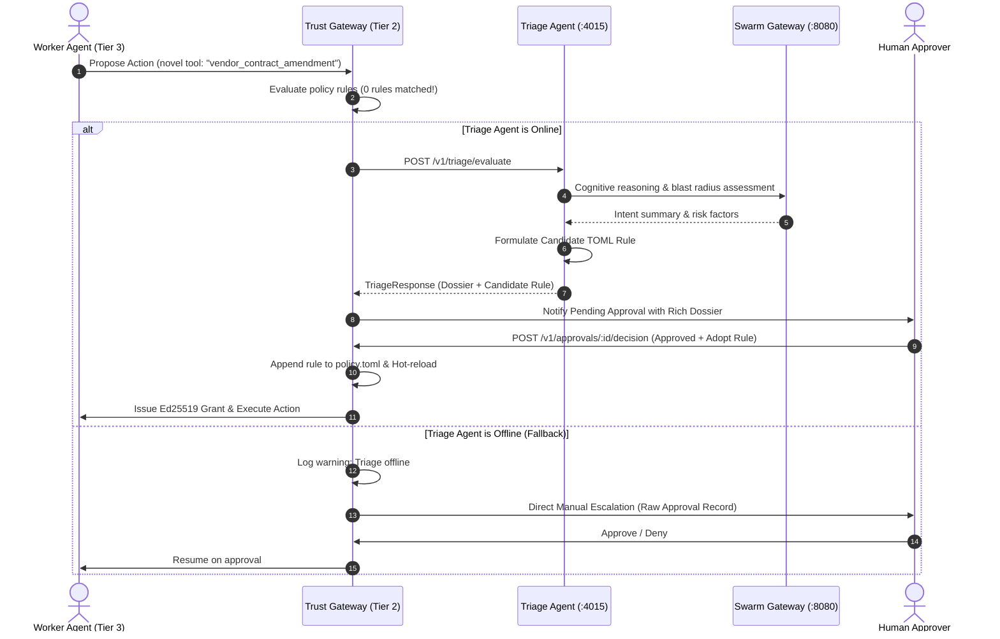

# Architecture: 4-Outcome Policy Engine & Cognitive Triage

> **Governing Principle:** *"Deterministic rules protect the enterprise. Cognitive triage enlightens the human. Humans seal the policies."*

---

## 1. Executive Summary in Plain Words

In an enterprise environment, autonomous AI agents continuously request to run tools (such as querying databases, calling external APIs, or sending notifications).

The **Marketplace Trust Gateway** acts as the security checkpoint (Execution Egress Firewall). Every time an agent asks to execute a tool, the Gateway evaluates the request against our security rules.

Instead of a simple "yes/no", the Gateway uses a **4-Branch Decision Engine**:

```text
Incoming Action
      │
      ├── 1. EXPLICIT REJECT    ──> Banned or dangerous action. Blocked immediately.
      ├── 2. EXPLICIT APPROVE   ──> Pre-certified, safe read-only action. Runs immediately.
      ├── 3. EXPLICIT ESCALATE  ──> Sensitive action (e.g. wire transfer > $10k). Always requires human approval.
      └── 4. UNMATCHED (NEW)    ──> Novel action that matches zero rules.
                                      │
                                      ├── Is Triage Agent online?
                                      │     ├── YES ──> Triage Agent analyzes risks, drafts a summary + new rule,
                                      │     │           then presents it to a human for 1-click approval.
                                      │     └── NO  ──> Direct Manual Escalation (safe default fallback).
```

---

## 2. The 4-Tier Topology Overview

Where does the Trust Gateway and Triage Agent fit in the overall enterprise stack?

```text
┌────────────────────────────────────────────────────────────────────────┐
│ TIER 4: OUTCOME ORCHESTRATOR (Goal decomposition & multi-agent DAGs)   │
└───────────────────────────────────┬────────────────────────────────────┘
                                    │
                                    ▼
┌────────────────────────────────────────────────────────────────────────┐
│ TIER 3: AUTONOMOUS WORKER AGENTS                                       │
│ • commercial_b2b_agent (:4010) — Executes domain business tasks        │
│ • triage_agent (:4015)         — Dedicated Governance & Rule Synthesis │
└───────────────────┬────────────────────────────────┬───────────────────┘
          1. Think  │                                │ 2. Request Action
          (Prompts) ▼                                ▼ (ProposedAction)
┌───────────────────────────────────────┐ ┌──────────────────────────────┐
│ TIER 1: SWARM GATEWAY                 │ │ TIER 2: TRUST GATEWAY        │
│ (Port 8088 / 8080)                    │ │ (Port 8081)                  │
├───────────────────────────────────────┤ ├──────────────────────────────┤
│ • LLM multiplexing (OpenAI/Gemini)    │ │ • 4-Outcome Policy Engine    │
│ • Token budget & cost enforcement     │ │ • Ed25519 ExecutionGrants    │
│ • Zero business credentials           │ │ • Sandboxed Native Runners   │
└───────────────────────────────────────┘ └──────────────┬───────────────┘
                                                         │ (If 0 rules match)
                                                         ▼
                                            Query triage_agent (:4015)
```

---

## 3. The 4 Gate Outcomes Explained

### Branch 1: Explicit Reject (Tier 3 Deny)
* **What happens:** A static rule explicitly matches with `action = "deny"`.
* **Examples:** Calling `rm -rf`, dropping production tables, downloading unapproved binaries, or accessing restricted internal admin APIs.
* **Outcome:** The Gateway drops the request immediately with `403 Forbidden`. No human is disturbed, and no AI model is queried.

### Branch 2: Explicit Approve (Tier 0 Auto)
* **What happens:** A static rule explicitly matches with `action = "allow"`.
* **Examples:** Certified read-only tools like checking weather (`claw_weather`), querying read replicas within quota, or fetching public catalog listings.
* **Outcome:** The Gateway mints a cryptographically bound Ed25519 `ExecutionGrant` in `< 1 ms` and executes the action inside the sandbox.

### Branch 3: Explicit Escalate (Tier 1/2 Human Approval)
* **What happens:** A static rule matches with `action = "require_approval"`.
* **Examples:** Financial transactions over $10,000, altering customer permissions, exporting bulk sensitive data.
* **Outcome:** Non-delegable to AI discretion. The Gateway pauses execution and generates an `ApprovalRecord`. The action will ONLY proceed if a designated human administrator verifies it with an authorized Passkey (WebAuthn) or Admin API Key.

### Branch 4: The Unmatched Frontier (Novel Actions)
* **What happens:** An autonomous worker calls a new tool or passes a set of parameters that does **not trigger any defined rule**.
* **The AI Triage Flow:**
  1. The Gateway contacts the standalone **Triage Agent** (`http://127.0.0.1:4015/v1/triage/evaluate`).
  2. The Triage Agent inspects the arguments, verifies the caller's identity via `commercial_b2b_agent`, and queries Swarm Gateway to evaluate intent.
  3. The Triage Agent compiles a **Risk Dossier** (blast radius, financial impact, reversibility) and synthesizes a **Candidate TOML Rule**.
  4. The human reviewer receives the pre-analyzed dossier and can approve the action and accept the new rule in one click.

---

## 4. End-to-End Sequence Diagram (Novel Tool Call)



---

## 5. The Fail-Safe Guarantee (Default Manual Fallback)

A critical architectural invariant in the Trust Gateway is **resilience through graceful degradation**:

* If `triage_agent` crashes, experiences high latency (> 2.5s), or is not deployed:
  * **The Gateway never fails open:** It will NEVER automatically allow an unvetted tool call.
  * **The Gateway never blindly drops work:** It will NOT reject the novel action with 403.
  * **It safely defaults to Direct Manual Escalation:** An approval request is immediately registered in the standard approval queue (`Tier1RequireHumanApproval`), ensuring business continuity and sovereign human control under all network conditions.

---

## 6. How the Gateway Evolves (Active Rule Synthesis)

When a human approver accepts an unmatched action, they can optionally toggle `accept_candidate_rule = true`:

1. **Synthesis:** The Triage Agent formats a clean, least-privilege TOML rule:
   ```toml
   [[rules]]
   name = "Auto-synthesized: Allow vendor invoice lookup under $500"
   tool_names = ["vendor_invoice_query"]
   operation_kind = "read"
   min_amount_cents = 50000
   action = "require_approval"
   priority = 14
   ```
2. **Safety Linters:** The gateway validates that the rule contains no wildcards (`*`) and fits within safe priority bounds (`11` to `19`), ensuring it can never override system-level security rules.
3. **Cryptographic Sealing:** The gateway re-computes the SHA-256 policy fingerprint, signs the updated policy using the Governance Ed25519 key, and hot-reloads it in memory.
4. **Result:** The next time any agent invokes this same action, it matches an explicit deterministic rule immediately with zero triage overhead.

---

## 7. Code Mapping Reference

| Component | Repository Path | Core Functionality |
|---|---|---|
| **Decision Model** | [`trust-sdk/src/model.rs`](../../../crates/trust-sdk/src/model.rs) | Defines `PolicyDecision`, `is_unmatched`, `matched_rule`, and governance tiers. |
| **Policy Engine** | [`trust-engine/src/policy.rs`](../../../crates/trust-engine/src/policy.rs) | Evaluates rules, detects zero-match conditions, and handles default escalation fallbacks. |
| **Pipeline Hook** | [`trust-engine/src/pipeline.rs`](../../../crates/trust-engine/src/pipeline.rs) | Step 8 dispatches to Triage Agent with automatic fallback to manual escalation. |
| **Approval Manager** | [`trust-engine/src/approval.rs`](../../../crates/trust-engine/src/approval.rs) | Stores `ApprovalRecord` enriched with `triage_dossier` and `candidate_rule`. |
| **Standalone Triage Agent** | [`triage_agent/`](../../../../triage_agent) | Standalone microservice on port 4015 performing cognitive triage and rule synthesis. |
